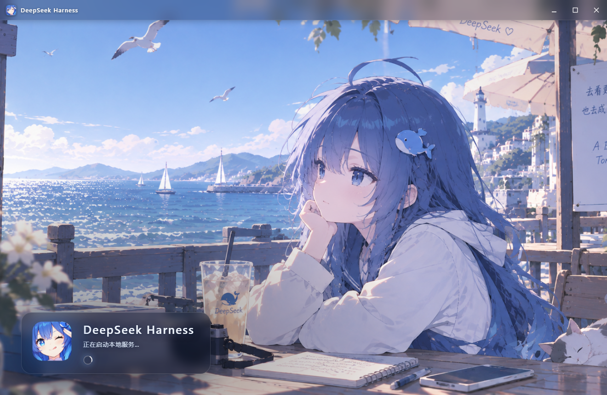
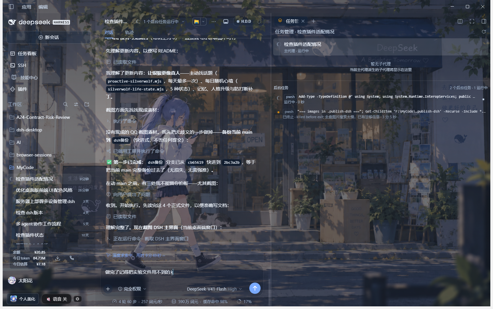
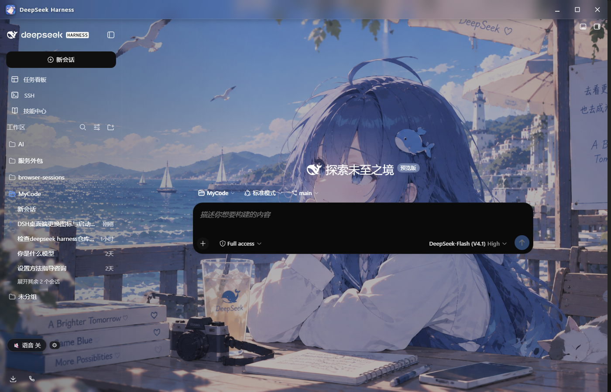
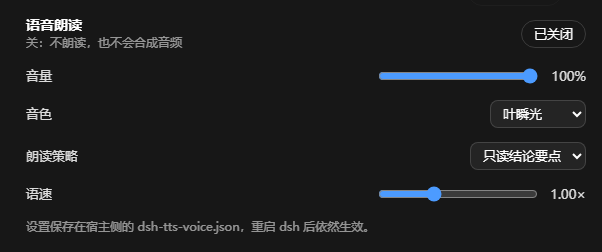

<div align="center">


# DeepSeek Harness 桌面端 · 插件与工具集

**把 DeepSeek Harness 装进一个像样的原生窗口，并附上一组本地插件与配套工具。**
Electron 桌面端（随机壁纸 · 窗口状态记忆 · 注入式标题栏） + 语音朗读插件 + 人格插件 + 双 Agent 协作桥 + QQ 群机器人补丁包。

[](#0-前置检查)
[](desktop/package.json)
[](#0-前置检查)
[](#上游来源与许可第三方)



<sub>启动界面：每次启动从 <code>desktop/assets/backgrounds/</code> 随机挑一张 —— 上面是「海边」，下面是「夜晚」</sub>


</div>

---

## 维护状态（2026-09-30）

**作者本机已改用官方桌面端**（`@deepseek-ai/dsh-desktop` 0.2.0-rc.2，自带 Electron 外壳与内置 dsh 运行时）。
本仓库的 [`desktop/`](desktop/) 自建外壳转为**存档参考** —— 代码仍然可用、仍按 MIT 分发，但不再跟随官方内核演进。



<sub>官方桌面端 + 本仓库的插件：侧栏（任务看板 / SSH / 技能中心 / 插件）、右侧任务面板、左下角余额挂件与语音开关</sub>

> **迁移的只是「外壳」那一层。** 自建壳的路线是自己拉起 `dsh web` 后端、再套一个注入式标题栏的原生窗口；
> 官方端已把外壳做进产品本身，于是这层不再需要。外壳之下的东西 —— `dsh` 内核、会话、凭据、插件、
> QQ 机器人补丁 —— 与外壳无关，本仓库的 [`plugins/`](plugins/)、[`profiles/web/`](profiles/web/)、
> [`qq-bot/`](qq-bot/) 照常可用。
>
> 自建壳原先的样子见 [`screenshot-dsh-ui.png`](screenshot-dsh-ui.png)（随机壁纸 + fairy 吉祥物 + 自绘标题栏）。

---

## 仓库里有什么

| 目录 | 是什么 | 是否必须装 | 文档 |
|---|---|---|---|
| [`desktop/`](desktop/) | **桌面端外壳**（Electron，独立 npm 项目）：自动拉起/复用 `dsh web`，无边框 + 注入式标题栏 + 随机壁纸 + 窗口状态记忆 | 否（但这是本仓库的主打） | [desktop/README.md](desktop/README.md) |
| [`profiles/web/`](profiles/web/) | `web` 配置档：插件 bundle 清单 + 本地鲸鱼挂件 + 浏览器桥，**全部相对路径链接**，可整目录搬移 | 是（要用桌面端就得装） | 见下 |
| [`plugins/dsh-tts-voice/`](plugins/dsh-tts-voice/) | **本地语音朗读插件**：GPT-SoVITS 逐句朗读，设置里有原生配置页 | 否 | [README](plugins/dsh-tts-voice/README.md) |
| [`plugins/dsh-persona-yeshunguang/`](plugins/dsh-persona-yeshunguang/) | **System Prompt 人格插件**：多人设、按 `agentPreset` 分流 | 否 | [README](plugins/dsh-persona-yeshunguang/README.md) |
| [`plugins/dsh-im-readonly/`](plugins/dsh-im-readonly/) | **IM 群聊只读闸门**：把群聊会话的权限预设锁成 `read-only` | 否 | [cordis.patch.yml](plugins/dsh-im-readonly/cordis.patch.yml) |
| [`install.ps1`](install.ps1) | Windows 一键安装：把 `plugins/`、`profiles/web/` 放到 `$DSH_HOME` 下并安装依赖 | 推荐 | 见下 |
| [`agent/`](agent/) | **双 Agent 协作桥**：Antigravity(Gemini) 当架构师、DSH 当实现员，含任务下发、安全快照、回滚 | 否 | 见下 |
| [`qq-bot/`](qq-bot/) | **QQ 群机器人补丁包**：给官方 QQ 机器人加语音条、用户识别、引用图片与权限控制 | 否 | 见下 |

> **`$DSH_HOME`** 全文指 DSH 的数据根目录：环境变量 `DSH_HOME` 有值就用它，否则是
> `C:\Users\<你的用户名>\.dsh`。下文凡出现 `$DSH_HOME` 都按这个规则展开。

---

## 安装

面向**一台全新的 Windows 机器**。按顺序执行，不要跳步。每步都给了「怎么算成功」。

### 0. 前置检查

```powershell
node -v      # 需要 v20 或更高
git --version
npm -v
```

任一缺失先补上（Node.js 从 <https://nodejs.org/> 装 LTS 版）。然后：

```powershell
# pnpm（安装 profiles/web 的依赖要用）
corepack enable
corepack prepare pnpm@11.7.0 --activate
pnpm -v

# dsh 本体
npm install -g @deepseek-ai/dsh
dsh --version
```

**成功判据**：`node -v` ≥ v20、`pnpm -v` 有输出、`dsh --version` 能打印版本号。

> 中国大陆网络可选配 GitHub 镜像：
> `git config --global url."https://gh-proxy.com/https://github.com/".insteadOf https://github.com/`

### 1. 克隆

```powershell
git clone https://github.com/sunflower224234/dsh_sunflower.git dsh-setup
cd dsh-setup
```

**成功判据**：当前目录下能看到 `install.ps1`、`desktop/`、`plugins/`、`profiles/`。

### 2. 一键安装（推荐）

```powershell
powershell -ExecutionPolicy Bypass -File .\install.ps1
```

脚本共 4 步：检查前置工具（含 Node 版本与 pnpm）→ 装 dsh（已装则跳过）→ 把 `plugins/` 与 `profiles/web/` 放到 `$DSH_HOME` → 安装 profile 依赖。

可用参数：

| 参数 | 作用 |
|---|---|
| `-SkipDshInstall` | 跳过 `npm install -g @deepseek-ai/dsh` |
| `-DshHome <路径>` | 指定目标目录，优先于环境变量 `DSH_HOME` |

例：

```powershell
powershell -ExecutionPolicy Bypass -File .\install.ps1 -SkipDshInstall
```

**成功判据**：脚本末尾打印「安装完成」，且下面这些路径都存在：

```powershell
$H = if ($env:DSH_HOME) { $env:DSH_HOME } else { Join-Path $HOME '.dsh' }

Test-Path "$H\plugins\dsh-tts-voice"                        # 本地插件已就位
Test-Path "$H\profiles\web\node_modules"                    # profile 依赖已装
Test-Path "$H\profiles\web\node_modules\dsh-tts-voice"      # 相对链接解析成功
```

> **为什么 `plugins/` 必须与 `profiles/` 同级**：`profiles/web/package.json` 里用
> `link:../../plugins/dsh-tts-voice` 这类**相对**链接引用它们。只有同级时相对路径才成立 ——
> 这也是 `install.ps1` 存在的意义（它按这个布局摆放，而不是随便拷到一个目录里）。
>
> 脚本遇到已存在的 `$H\plugins`、`$H\profiles\web` 会先改名为 `.bak` 再覆盖，
> **重复执行是安全的**。

**已知的无害告警**：`pnpm install` 阶段可能看到 `cpu-features` / `ssh2` 的 `node-gyp` 编译失败。
那是 `@linxin666/dsh-ssh` 的可选原生加速模块，**缺少 Visual Studio C++ 工具链时会跳过**，
不影响安装结果（实测安装可正常完成）。要让它们也编过，装 VS 的「使用 C++ 的桌面开发」工作负载。

### 3. 手动分步（脚本失败时走这条）

等价的手工流程。**顺序不能颠倒** —— `profiles/web` 用相对路径 `link:` 指向 `plugins/`，
目标必须先存在。

```powershell
$H = if ($env:DSH_HOME) { $env:DSH_HOME } else { Join-Path $HOME '.dsh' }
$Repo = (Get-Location).Path      # 仓库根

# --- 3.1 本地插件：搬运（profiles/web 的相对链接指向这里） ---
Copy-Item -Recurse -Force "$Repo\plugins" "$H\plugins"

# --- 3.2 web profile：搬运 + 装依赖 ---
New-Item -ItemType Directory -Force -Path "$H\profiles" | Out-Null
Copy-Item -Recurse -Force "$Repo\profiles\web" "$H\profiles\web"
cd "$H\profiles\web"
pnpm install
```

**成功判据**：同第 2 步的三个 `Test-Path` 全为 `True`。

### 4. 配置凭据

在 dsh 的凭据界面配置下列键（桌面端与 Web 端共用同一份凭据存储）：

| 键 | 必需性 | 用途 |
|---|---|---|
| `DEEPSEEK_API_KEY` | **必需** | 模型调用；鲸鱼挂件的余额显示也依赖它 |
| `DEEPSEEK_PLATFORM_TOKEN` | 可选 | 鲸鱼挂件的「实时·令牌」用量模式 |

> **不要把凭据写进仓库。** `.credentials.yaml`、`.env*` 已在 `.gitignore` 里，
> 但**新建的配置文件不会自动被忽略**，提交前请再确认一次 `git status`。

`profiles/web/cordis.patch.yml` 里 `dsh-doc` 的运行时目录是用 `!!js` 从环境变量动态解析的，
不需要手工改：

```yaml
runtimeDir: !!js process.env.DSH_HOME + '\\runtimes\\dshdoc-runtime-win32-x64'
```

**成功判据**：`dsh web` 启动后浏览器能正常对话；鲸鱼挂件显示余额。

### 5. 启动桌面端

桌面端是**独立的 npm 项目**，不经过 `install.ps1`，也不需要放进 `$DSH_HOME`：

```powershell
cd <仓库路径>\desktop
.\start.bat
```

首次运行会 `npm install`（含 Electron 运行时，约 150MB），之后每次双击即启动。
`start.bat` 会先探测 `127.0.0.1:3080`：已在跑就复用，没跑就自己拉起后端子进程，关窗时一并收干净。

**成功判据**：出现无边框窗口、显示随机壁纸的启动界面，随后进入 dsh 主界面。

### 6. 可选组件的独立安装

#### 6.1 语音朗读插件（`plugins/dsh-tts-voice`）

先决条件：本地已部署 **GPT-SoVITS V2**（插件默认找 `F:/AI/GPT-SoVITS`，可用 `DSH_TTS_DIR` 覆盖）。

跑过 `install.ps1` 的话，插件已在 `$DSH_HOME\plugins\` 下、profile 也已链接好，**无需额外操作**。
只想单独装这一个插件时：

```powershell
$H = if ($env:DSH_HOME) { $env:DSH_HOME } else { Join-Path $HOME '.dsh' }
Copy-Item -Recurse -Force .\plugins\dsh-tts-voice "$H\plugins\dsh-tts-voice"
cd "$H\profiles\web"
pnpm install          # 让 link: 链接生效
```

然后**重启 `dsh web`** 并刷新浏览器。左下角出现语音悬浮按钮即生效。

常用环境变量（全部可省略，完整表见 [插件 README](plugins/dsh-tts-voice/README.md)）：

| 变量 | 默认 | 说明 |
|---|---|---|
| `DSH_TTS_DIR` | `F:/AI/GPT-SoVITS` | GPT-SoVITS 部署目录 |
| `DSH_TTS_URL` | `http://127.0.0.1:9880/tts` | TTS 接口地址 |
| `DSH_TTS_ENABLED` | `1` | 启动时是否开启朗读（设为 `0` 或 `false` 关闭） |

#### 6.2 人格插件（`plugins/dsh-persona-yeshunguang`）

跑过 `install.ps1` 就已装好。**但它默认不加载任何人设文件** —— 需要你自备人设 `.md` 并配置路径
（见下方「[改哪些写死的路径](#改哪些写死的路径不是形式但同样必须改)」）。

#### 6.3 双 Agent 协作桥（`agent/`）

无额外安装步骤，直接用 `node` 跑脚本。**必须在仓库根目录执行** —— 脚本按仓库根解析
`.agent/inbox`、`.agent/backups` 这类相对路径。

> 注意：`agent/bridge/cli.mjs` 内置帮助里写的是 `node .agent/bridge/cli.mjs`（带前导点），
> 而仓库里的真实目录是 `agent/bridge/`（不带点）—— **以 `agent/bridge/` 为准**。

#### 6.4 QQ 群机器人（`qq-bot/`）

先决条件：

- **QQ 机器人开放平台**已创建机器人（appId + AppSecret），并已开通群聊能力；
- **`@xmanrui/dsh-im` ≥ 4.19**（补丁针对其 bundle 结构）；
- 本地 **GPT-SoVITS 服务**（银狼音色权重 + 参考音频）；
- 可选：Gemini / Antigravity 环境（仅反向委托多模态任务时需要）。

```powershell
cd <仓库根>
node qq-bot/apply-voice-patch.mjs            # 预演，不写文件
node qq-bot/apply-voice-patch.mjs --apply    # 实际应用
node qq-bot/apply-voice-patch.mjs --revert   # 从 backup/ 恢复
```

四个补丁脚本用法一致（`--apply` / `--revert`，无参数即预演）：`apply-voice-patch.mjs`、
`apply-sender-identity-patch.mjs`、`apply-quoted-image-patch.mjs`、`apply-approver-patch.mjs`。

> ⚠️ **这些脚本里含 `<<<占位符>>>`，动手前先走一遍下面的「占位符替换清单」。**

---

## 占位符替换清单

仓库里有一批 `<<<...>>>` 占位符，是「换台机器装不上」的头号原因。
**`agent/` 与 `qq-bot/` 里的脚本都不可用之前，先把这张表填完。** 全局搜索 `<<<` 逐个替换。

| 占位符 | 出现在哪些文件 | 替换成什么 |
|---|---|---|
| `<<<DSH_HOME>>>` | `qq-bot/apply-*-patch.mjs`、`qq-bot/probe-*.mjs`、`agent/collab-persona.md`、`agent/SKILL-FIXATION-REPORT.md` | DSH 数据根目录。注意脚本里是**正斜杠**写法（`<<<DSH_HOME>>>/profiles/web/...`），换成 `C:/Users/<你>/.dsh` 这类正斜杠路径 |
| `<<<GPT-SoVITS目录>>>` | `qq-bot/silverwolf-tts.mjs`、`qq-bot/start-tts-service.mjs` | 本地 GPT-SoVITS 部署目录，例如 `F:/AI/GPT-SoVITS` |
| `<<<插件目录>>>` | `qq-bot/silverwolf-tts.mjs`、`qq-bot/probe-group-voice.mjs`、`qq-bot/persona-银狼.md` | 本仓库 `qq-bot/` 的实际绝对路径（脚本用它定位 `out/` 输出目录） |
| `<<<协作桥目录>>>` | `qq-bot/persona-银狼.md`、`agent/specs/collab-bili-01.md`、`agent/bridge/test-bili-summary.mjs`、`agent/collab-persona.md` | 本仓库 `agent/` 的实际绝对路径 |
| `<<<你的QQ_OWNER_OPENID>>>` | `qq-bot/persona-银狼.md`、`qq-bot/measure-token-cost.mjs` | 你自己的 QQ openid（**身份白名单依据，泄露等于把权限开放给别人**） |
| `<<<工作区>>>` | `agent/specs/collab-bili-01.md`、`agent/SKILL-FIXATION-REPORT.md` | 机器人默认工作区路径 |
| `<<<数据目录>>>` | `agent/specs/collab-bili-01.md` | 存放人设提示词等数据的目录 |
| `<<<你的appId>>>` | `qq-bot/probe-group-voice.mjs` | QQ 机器人的 appId |

查漏（在仓库根执行）：

```powershell
Get-ChildItem -Recurse -File |
  Where-Object { $_.FullName -notmatch '\\\.git\\|node_modules' } |
  Select-String -Pattern '<<<[^>]+>>>' |
  ForEach-Object { "{0}:{1}  {2}" -f $_.Path, $_.LineNumber, $_.Matches[0].Value }
```

### 改哪些写死的路径（不是 `<<<>>>` 形式，但同样必须改）

| 文件 | 改什么 |
|---|---|
| `plugins/dsh-im-readonly/cordis.patch.yml` | `stores[].file` 里的 `C:/Users/<原作者>/.dsh/integrations/dsh-qq/bots/<botId>/state.json` 是**生效配置**，必须换成你自己的 `$DSH_HOME/integrations/dsh-qq/bots/<你的botId>/state.json`（`bots\` 下的目录名即 botId）。接入第二个机器人就再加一条 `stores` 项 |
| `plugins/dsh-persona-yeshunguang/cordis.patch.yml` | 文件里的 `personas[].file`（`F:/AI/data/*.md`）**默认整段是注释掉的**，所以插件默认不加载人设。要启用人设，取消注释并把 `file:` 指向你自备的人设 `.md`（第一次 ```` ```text ```` 代码块即人设正文）。这两个人设文件**不在本仓库内** |

---

## 验证安装成功的检查清单

按顺序打勾。前几项是「框架装好了」，后几项按你实际装的组件选做。

- [ ] **dsh 可用**：`dsh --version` 打印版本号
- [ ] **profile 依赖已装**：`Test-Path "$H\profiles\web\node_modules"` 为 `True`，且其下能看到 `dsh-tts-voice`、`dsh-persona-yeshunguang`、`dsh-im-readonly`（指向 `$H\plugins\` 的链接）
- [ ] **配置生效**：`dsh --profile web` 启动后能在浏览器里正常对话
- [ ] **桌面端自测**：`desktop` 下测试脚本全绿（见「[自测命令](#自测命令)」）
- [ ] **语音插件自测**：`plugins/dsh-tts-voice` 下四个测试脚本全过
- [ ] **端到端**：随机壁纸正常、鲸鱼挂件显示余额

---

## 双 Agent 协作（`agent/`）

让 **Gemini（Antigravity，架构与验收总监）** 和 **DSH（DeepSeek Harness，核心编码实现员）** 组成一条流水线：
架构师划边界、下规格书，实现员在受限范围内改代码、跑自测、按交付卡回报。

**核心设计：不靠复制粘贴，靠文件总线。** 两个 Agent 通过 `.agent/` 下的约定文件交换任务与结果，
人类始终在环里当最终决策者。

| 文件 | 作用 |
|---|---|
| `bridge/cli.mjs` | 任务下发入口：建安全快照 → 交给 DSH 执行 → 审计改动 |
| `bridge/dsh-runner.mjs` | 执行通道：优先直连运行中的 DSH 桌面端会话（实时可见、保留上下文），桌面端不在则降级为 headless CLI |
| `bridge/safety-guard.mjs` | 动工前对目标文件做精确快照，支持一键回滚 |
| `bridge/handoff.mjs` | **反向委托**：DSH 遇到多模态短板（长视频、复杂画面）时，把任务投给具备视觉能力的 Gemini |
| `bridge/collab-smoke.mjs` | 链路自检：验证「人设注入」等 8 项断言 |
| `bridge/bili-*.mjs` / `kb-search.mjs` | B 站视频省流与知识库检索（供 QQ 机器人调用） |
| `collab-persona.md` | 实现员人设的离线可读副本 |

**用法**（在仓库根目录执行，下面是 PowerShell，续行符是反引号）：

```powershell
# 下发一个受限任务（--targets 是白名单，越界即报错）
node agent/bridge/cli.mjs run `
  --id "task-20260914-0100" `
  --title "任务简述" `
  --targets "要改的文件1,要改的文件2" `
  --prompt "目标 / 约束 / 验收命令"

# 审计改动、一键回滚
node agent/bridge/cli.mjs audit    --id <ID>
node agent/bridge/cli.mjs rollback --id <ID>

# 反向委托多模态任务
node agent/bridge/handoff.mjs --video "<视频路径>" --prompt "<分析要求>"

# 链路自检
node agent/bridge/collab-smoke.mjs
```

> 任务编号约定 `task-YYYYMMDD-HHMM`。所有下发都会先落快照，改坏了随时回退。
>
> `collab-smoke.mjs` 会去读 `$DSH_HOME\profiles\collab\cordis.patch.yml` 里的实现员人设。
> **本仓库只分发 `web` 一个 profile**，所以那个 `collab` profile 需要你自己建，否则该自检会失败；
> 其余功能（下发、快照、回滚、反向委托）不依赖它。

### 设计取舍（值得说明）

- **为什么要文件总线而不是函数调用**：两个 Agent 运行在不同进程、不同模型、甚至不同网络环境，
  文件是最低耦合、可审计、可回溯的交换介质；出问题能直接翻 `.agent/` 下的原始记录。
- **为什么要 `--targets` 白名单**：Agent 自主改代码最大的风险是「顺手改了别处」。
  白名单把爆炸半径锁死在声明范围内，配合快照形成「越界即回滚」。
- **为什么优先直连桌面端**：headless 每次新起进程，上下文不连续、看不见中间过程；
  直连正在运行的会话可以实时流式显示思考与工具调用，且 KV Cache 命中更好。

---

## QQ 群机器人（`qq-bot/`）

把本地大模型能力接进 QQ 群，且**全部基于官方 SDK，不依赖任何第三方协议实现**。
这里有四件成品能力，每一件都是对上游插件的**受控补丁**（可重打、可回滚）。

| 能力 | 效果 |
|---|---|
| **语音条** | 银狼（本地 GPT-SoVITS 训练音色）在群里发**原生语音条**，不是文件卡片 |
| **用户识别** | 她知道**谁在说话**，能叫出群昵称；同一个人连续发消息不会被当成「复读」 |
| **引用图片** | 手机 QQ 无法「图 + 文」同发时，群友先发图、再引用后 @她 —— 她能读到那张图 |
| **权限控制** | 群聊里改文件类操作，只认群主批准；群友自己批准无效 |

### 让机器人像个活人（分气泡 / 主动性 / 每日心境 / 人格升级）

上面四件是**通道能力**（怎么把消息发出去）；下面四件是**人格工程**（让她不像客服，像群里一个真实的人）。

| 文件 | 做什么 |
|---|---|
| [`apply-qq-break-patch.mjs`](qq-bot/apply-qq-break-patch.mjs) | **让 `[break]` 真的分气泡。** 人设要求用 `[break]` 把回复拆成 2~3 条短消息，但 `dsh-im` 任何版本都不解析这个标记（4.19.2 与 4.28.1 的 bundle 里都搜不到），一直原样发给用户。补丁只改一处：在 `chunkMarkdownParts` 函数体开头插入分片守卫，遇到 `[break]` 就递归切分。发送逻辑（`msg_seq` 递增、markdown 被拒回退纯文本、超长溢出提示）一行不动 |
| [`silverwolf-life-state.mjs`](qq-bot/silverwolf-life-state.mjs) | **每天换一种心境。** 按日期哈希从 5 种状态里选一个（大版本更新·微暴躁 / 十连双金·得意 / 联机翻车·带刺 / 折腾键帽·手痒 / 挂机摸鱼·悠闲），再叠加当前时段的作息（凌晨补觉 / 中午挂机 / 下午摸鱼 / 夜晚攻坚）。导出 `getSilverwolfLifePrompt()` 供人设注入 |
| [`proactive-silverwolf.mjs`](qq-bot/proactive-silverwolf.mjs) | **会主动找话题。** 按日期哈希从 14 条闲聊里选一句，在当天 18:00–22:00 之间的某个时刻投到群里，**一天最多一条**（状态文件去重）。配合计划任务每 30 分钟跑一次即可；`--preview` 可以只看当天会发什么而不真发 |
| [`upgrade-silverwolf-persona.mjs`](qq-bot/upgrade-silverwolf-persona.mjs) | **人格升级脚本。** 对源人设做四处精确替换：说话风格去掉口头禅套路、聊天节奏不再固定三段式、few-shot 从「复读原句」改成「学反应方式」、新增「银狼自己的生活与连续性」章节。输出候选文件供人工审核 |

> **为什么用日期哈希而不是 `Math.random()`**：同一天里反复运行结果稳定 —— 不会刷新一次就换一个心情，
> 换一天才换。这是「连续性」的前提，也是人设里「已经说过的事保持一致」能成立的原因。
>
> `apply-qq-break-patch.mjs` 沿用本目录的补丁规范：锚点唯一性校验 → 应用 → 7 项复检 → 自动备份，
> 任一项不过就**不写文件**；`--revert` 从 `qq-bot/backup/` 恢复。
>
> `proactive-silverwolf.mjs` 要求 `$DSH_HOME/integrations/dsh-qq/workspaces.json` 里**恰好一个群投递目标**，
> 多于一个会直接报错退出（避免误把私聊也算进去）；接口地址可用 `DSH_IM_ORIGIN` 覆盖（默认 `http://127.0.0.1:3080`）。

### 前置认知（踩过的坑，省得你重踩）

- **QQ 官方只接受 `file_type=3` 上传富媒体，但 wav 可以直接发**，不需要 silk 转码。
  官方两份文档自相矛盾，实测以《富媒体消息概述》为准。
- **语音响应在 40 秒量级**：GPT-SoVITS 首次加载模型要等，别指望秒回。
- **上游 `@xmanrui/dsh-im` 升级会覆盖补丁。** 本目录的脚本都用「锚点唯一性 + 应用后复检」双门禁，
  **锚点对不上会明确报错退出**，不会静默改坏。
- **必须改 bundle**：补丁针对 `dsh-im` 的 **8MB 压缩 bundle**（运行时只加载 `lib/index.js`，
  `src/` 不参与运行），所以这类改动只能改 bundle —— 这也是为什么用脚本而不是直接编辑。

### 目录说明

```
qq-bot/
├── apply-voice-patch.mjs            # 语音条：audio/* 走 sendVoice
├── apply-sender-identity-patch.mjs  # 用户识别：补 contextSource，把 senderName/senderId 送进上下文
├── apply-quoted-image-patch.mjs     # 引用图片：被引用消息里的图并入 images[]
├── apply-approver-patch.mjs         # 权限：群聊审批只认指定 openid
├── set-context-enhancement.mjs      # 启用上下文增强（走 dsh-im 管理端点）
├── compact-context-guidance.mjs     # 精简增强提示词（197 → 80 tokens/条）
├── silverwolf-tts.mjs               # 调本地 GPT-SoVITS 合成 wav
├── start-tts-service.mjs            # TTS 常驻启动器（轮询端口判就绪，比官方脚本可靠）
├── apply-qq-break-patch.mjs         # 分气泡：让 [break] 真的拆成多条消息
├── silverwolf-life-state.mjs        # 每日心境 + 时段作息（注入人设）
├── proactive-silverwolf.mjs         # 主动找话题（一天最多一条）
├── upgrade-silverwolf-persona.mjs   # 人格升级脚本（输出候选供人工审核）
├── persona-银狼.md                  # 群机器人人设（含语音触发与权限规则）
└── probe-*.mjs / *-session-*.mjs    # 诊断：验证通道、读会话事件
```

> ⚠️ 这些脚本里含 `<<<DSH_HOME>>>`、`<<<GPT-SoVITS目录>>>`、`<<<插件目录>>>`、
> `<<<你的QQ_OWNER_OPENID>>>` 等占位符，动手前先走一遍
> 「[占位符替换清单](#占位符替换清单)」。

---

## 桌面端

<div align="center">

</div>

- **双击即用**：`desktop\start.bat` 先探测 `127.0.0.1:3080` —— 已在跑就直接复用，没跑就自己拉起来；
  关窗时把后端子进程树一起收干净。
- **随机壁纸**：`desktop/assets/backgrounds/` 里现有 **11 张 WebP**（白天 / 夜晚 / 海边 / 街头 ×2，
  外加 6 张 DeepSeek 鲸鱼主题插画），总计约 2.9MB。每次启动随机挑一张，
  **启动界面与主界面用同一次随机结果**。增删图片即可换壁纸，不用改代码。
- **窗口状态会被记住**：尺寸、位置、是否最大化存在 `%APPDATA%\dsh-desktop\window-state.json`，
  下次原样恢复。最大化时记的是**还原尺寸**，所以「最大化 → 关闭 → 再开」不会把窗口永久顶满屏；
  拔掉外接屏后会自动只丢位置、保留尺寸，避免窗口跑到看不见的地方。
- **无边框 + 注入式标题栏**：标题栏由 preload 注入并做毛玻璃，让真实壁纸透上来；
  窗口控制、品牌标、壁纸层同源。
- **一套美术资源两处复用**：`assets/icon-src.png` 既生成 `icon.ico`（多尺寸，任务栏/资源管理器），
  也生成 `splash.png`（标题栏 24px 品牌标 + 启动界面 Logo）：

  ```powershell
  cd desktop
  powershell -ExecutionPolicy Bypass -File .\make-icon.ps1
  ```

壁纸清单（全部 `.webp`，1672×941）：

| 文件 | 画面 |
|---|---|
| `bg-day-1.webp` | 白天 |
| `bg-night-2.webp` | 夜晚（文件名含 `night`，启动界面自动用更轻的压暗） |
| `bg-seaside.webp` | 海边 |
| `bg-street.webp` | 街头 |
| `bg-street-2.webp` | 街头 · 店门口 |
| `bg-desk-day.webp` | 书桌 · 白天（阳光、鲸鱼抱枕） |
| `bg-desk-night.webp` | 书桌 · 夜晚（城市夜景 + 显示器） |
| `bg-riverside-dusk.webp` | 江边步道 · 黄昏（晚霞、路灯） |
| `bg-matsuri.webp` | 夏日祭 · 烟花（浴衣、灯笼、鸟居） |
| `bg-overlook.webp` | 山坡俯瞰海湾 · 入夜（湿润街道、大月亮） |
| `bg-summer-night.webp` | 夏日黄昏（自动贩卖机、远处花火大会） |

> 加图/删图都不用改代码：`main.js` 的 `pickBackground()` 每次启动现扫 `assets/backgrounds/`
> （过滤 `png/jpg/webp`），随机取一张，并**避开上次用过的那张**（记录在
> `%APPDATA%\dsh-desktop\window-state.json` 的 `lastBackground` 字段，重启进程后依然有效）。
> 排除上一张后其余等概率 —— 仍是随机，只是不会出现「连着两次一模一样」；只有一张图时自然就选它。
> 壁纸源素材（PNG 原图）在 `desktop/assets/backgrounds/` 之外的本地素材目录，未随仓库分发。

---

## 语音朗读插件

<div align="center">

</div>

- **它是真插件，不是脚本注入**：声明 `dsh.client` + `exports["./client"]`，客户端 bundle 由 dsh 的
  boot 图加载，因此在**设置里长出原生一页**（总开关 / 音量 / 音色 / 朗读策略 / 句数上限 / 语速）。
- **开关状态不再分叉**：设置的真源是宿主侧文件（原子写）。以前开关同时存在浏览器 localStorage
  与服务端内存两处、服务端一重启就重置；现在前端每次轮询都对齐宿主真源，**重启 dsh 后开关状态照旧**。
- **像日常沟通，而不是朗读版屏幕阅读器**：默认只读「结论要点」，过程话
  （「让我先看一下…」/「I'll check…」）跳过；Markdown 记号、表格、URL、盘符路径、「文件:行号」、
  代码块、emoji 全部清洗；**工具调用与中间状态在事件层就被过滤，结构上不会被念出来**。
- **不白占资源**：语音关着时启动**不预热模型**，在设置里关掉会立刻停掉自己拉起的 TTS 进程；
  未被消费的音频达到 12 段 / 24MB 就暂停合成，超时自动丢弃。
- 左下角悬浮按钮：**单击即开/关**，旁边 ⚙ 单击展开说明（不再是 hover 才能用）。

---

## 自测命令

全部在仓库根目录执行。`$H` 按前文规则展开。

```powershell
# --- 桌面端 ---
cd desktop

# 窗口状态记忆（17 项断言，独立 userData 目录，不动你的真实记忆文件）
node_modules\electron\dist\electron.exe --user-data-dir="$env:TEMP\dsh-wtest" .\test-window-state.js

# 壁纸选择策略（12 项断言，含「不排除时确实会连着重复」的对照组）
node_modules\electron\dist\electron.exe --user-data-dir="$env:TEMP\dsh-bgtest" .\test-background-pick.js

# 后端生命周期（纯 Node，不需要 Electron）
node .\test-backend.js

cd ..
```

```powershell
# --- 语音插件（不需要 dsh 运行）---
node plugins\dsh-tts-voice\test\read-policy.test.mjs
node plugins\dsh-tts-voice\test\host-integration.test.mjs
node plugins\dsh-tts-voice\test\client-behavior.test.mjs
node plugins\dsh-tts-voice\test\client-dom.test.mjs

# --- 其它本地插件 ---
node plugins\dsh-im-readonly\test\group-gate.mjs
node plugins\dsh-persona-yeshunguang\test\zh-pro-chain.mjs
```

> 桌面端前两个自测**必须用独立 `--user-data-dir`**，否则会写到你真实的窗口状态记忆文件。

---

## 常见问题

**Electron 运行时下载慢 / 失败**
`start.bat` 会先设 `ELECTRON_MIRROR=https://npmmirror.com/mirrors/electron/` 再下载，失败后清空该变量
用默认源重试。仍失败就手动跑：

```bat
cd desktop
set ELECTRON_MIRROR=https://npmmirror.com/mirrors/electron/
node node_modules\electron\install.js
```

**`pnpm install` 报错**
1. 确认 `pnpm -v` 是 `11.7.0`（`corepack prepare pnpm@11.7.0 --activate`）。
2. `link:` 目标不存在会导致安装失败 —— 先确认 `$H\plugins\dsh-*` 已就位，
   顺序不能颠倒（见第 3 步）。
3. 看到 `cpu-features` / `ssh2` 的 `node-gyp` 报错可以先忽略（见第 2 步的「已知的无害告警」）。
4. 网络问题可试 `pnpm install --registry=https://registry.npmmirror.com`。

**3080 端口被占用**
桌面端会自动改用系统分配的随机端口，一般无需处理。想固定端口就在 `desktop\start.bat` 里加一行
`set DSH_PORT=8090`，或：

```bat
set DSH_PORT=8090
call npm start
```

**浏览器扩展呢？**
本仓库**暂不分发** `dsh-browser/`（浏览器桥 + Chrome/Firefox MV3 扩展）—— 扩展侧还在更新，
当前接上也不可用，所以从仓库和默认 profile 里摘掉了，免得装上一套用不了的东西。

需要时自行从上游获取：[Lum1104/dsh-browser](https://github.com/Lum1104/dsh-browser)（MIT）。

**GPT-SoVITS 路径不对**
插件默认找 `F:/AI/GPT-SoVITS`。换机器后设置 `DSH_TTS_DIR` 指向你的部署目录，同时把
`qq-bot/silverwolf-tts.mjs`、`qq-bot/start-tts-service.mjs` 里的 `<<<GPT-SoVITS目录>>>` 替换掉。
确认服务在 `127.0.0.1:9880` 有响应。

**补丁脚本报「锚点命中数不为 1」**
`@xmanrui/dsh-im` 版本变了（补丁针对 ≥4.19 的 bundle 结构）。脚本**不会写坏文件**，会直接退出。
解决：`--revert` 后改用匹配新版本的补丁，或回退 `dsh-im` 版本。

**设置了人设但角色「出戏」**
`dsh-persona-yeshunguang` 与 `deepseek-harness-zh_pro` 都包装 `systemPrompt.assemble`，
这是最脆弱的一处耦合。详见
[插件 README 的包装链契约一节](plugins/dsh-persona-yeshunguang/README.md)。
另外**已有会话不会自动换人设** —— preset 只在会话创建时读取，改完要发一次 `/new`。

**提交前发现凭据**
检查 `git status`，确认没有 `.credentials.yaml`、`.env*`。

---

## 上游来源与许可（第三方）

本仓库**复制（vendor）**了以下第三方项目源码，各自遵循其原始许可证：

- `profiles/web/local-plugins/whale-widget/` — 来自 [MeteorNOX/DeepSeek-Balance-Whale-Widget](https://github.com/MeteorNOX/DeepSeek-Balance-Whale-Widget)（含本地改动）。

如需升级这些上游组件，请从对应上游仓库拉取最新版本；本仓库不会自动同步。

`desktop/`、`plugins/`、`agent/`、`qq-bot/` 为本人自写代码，MIT 授权。
桌面端的美术资源（图标与壁纸）仅随本仓库用于个人使用，请勿单独再分发。
